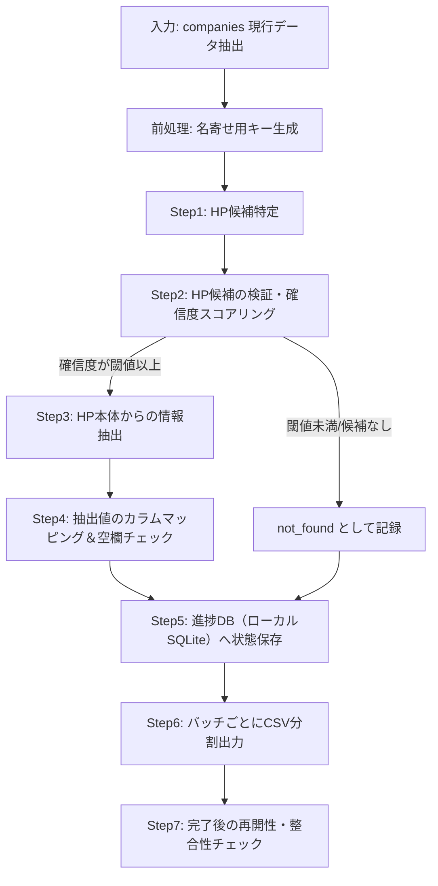

# LegatusONE 企業情報エンリッチメント（HP特定・空欄補完）仕様書

**対象テーブル**: `companies`（列定義: `studio_results_20260920_2224.csv` に準拠、約250カラム）
**対象データ件数**: 約500万件
**前提**: 本番DBは現在停止中のため、処理結果は一旦CSVで保持し、DB復旧後に取り込む
**実行時間制約**: なし（バッチとして継続実行可能）

---

## 1. 目的

`companies` テーブルは複数のインポート元（帝国データバンク系、法人番号システム、独自スクレイピング等）からデータが混在しており、同一意味のカラムが複数存在する（後述「4. カラム重複問題」）一方で、多くの行で主要カラムが空欄になっている。

本仕様書では、
1. 企業の公式HP（ホームページ）を自動的に特定し、
2. HPおよび関連する公開情報から企業情報を収集し、
3. `companies` テーブルの**空欄カラムのみ**を埋める（既存値は上書きしない）
4. 結果をインポート可能なCSV群として出力する

処理フローと出力仕様を定義する。

---

## 2. 全体アーキテクチャ



処理は「1社ずつのパイプライン」として設計し、途中失敗しても**企業単位でリトライ可能**にする。500万件×多段処理のため、真の意味での完了は数週間〜数ヶ月かかる想定であり、常時稼働・中断再開前提の設計とする。

---

## 3. スコープ定義（今回HP経由で埋められるカラム／埋められないカラム）

250カラムすべてをHPスクレイピングで埋めることは非現実的なため、**取得元別にスコープを明示**する。

### 3-1. HP・Web公開情報から充足可能（本仕様の主対象）

| カテゴリ | 対象カラム例 |
|---|---|
| URL系 | `url`, `homepage_url`, `website_url`, `company_url`, `urls`, `contact_form_url` |
| 連絡先 | `phone_number`, `tel`, `contact_phone_number`, `fax`, `email` |
| 所在地 | `headquarters_address`, `address`, `postal_code`, `zip_code`, `postcode` |
| 代表者（公開情報のみ） | `representative_name`, `representative_kana`, `representative_title` |
| 役員情報（HP「会社概要/役員一覧」ページ） | `executive_name1〜10`, `executive_position1〜10` |
| 設立・沿革 | `founded_year`, `founding_year`, `established`, `established_date`, `establishment_date`, `date_of_establishment` |
| 事業内容・概要 | `overview`, `company_description`, `business_summary`, `summary`, `short_description`, `description`, `business_items`, `specialties`, `business_descriptions` |
| 従業員数（HP記載値） | `employee_count`, `employees`, `number_of_employees` |
| 資本金（HP記載値） | `capital_stock`, `capital` |
| 拠点情報 | `office_count`, `number_of_offices`, `factory_count`, `number_of_factories`, `store_count`, `number_of_stores`, `branch_office_*` |
| SNS/採用 | `facebook`, `linkedin`, `wantedly`, `youtrust` |
| メタ情報 | `meta_description`, `meta_keywords` |

### 3-2. HPのみでは不十分・別データソースが必要（本仕様では「取得できれば追加、必須ではない」）

| カテゴリ | 対象カラム例 | 推奨データソース |
|---|---|---|
| 財務数値 | `revenue`, `revenue1〜5`, `profit`, `profit1〜5`, `total_assets`, `net_assets`, `operating_income`, `latest_revenue`, `latest_profit` | 決算公告・EDINET（上場のみ）・帝国データバンク等の有償データベース。HP記載の売上はIR/プレスリリースのみ拾える |
| 法人番号系 | `corporate_number`, `corporate_number_source` | 国税庁法人番号公表サイトAPI／gBizINFO API |
| 上場関連 | `listed`, `securities_code`, `market_segment`, `listed_parent_*` | EDINET / 取引所公表情報 |
| 代表者個人情報 | `representative_address`, `representative_home_address`, `representative_birth_date`, `representative_registered_address` | **原則取得しない**（4-4参照。個人情報保護の観点で対象外とする） |

### 3-3. 対象外（後続フェーズ or 別プロジェクト）

`related_companies`, `shareholders`, `subsidiaries`, `banks` など関係性データはHP単体では確度が低いため、本フェーズでは対象外とし、将来の別バッチで検討する。

---

## 4. カラム重複問題への対応方針

現行スキーマには同一意味のカラムが複数存在する（インポート元が異なるため）。例:

- URL: `url` / `urls` / `homepage_url` / `website_url` / `company_url`
- 従業員数: `employee_count` / `employees` / `number_of_employees`
- 郵便番号: `postal_code` / `zip_code` / `postcode`
- 設立: `founded_year` / `founding_year` / `established` / `established_date` / `establishment_date` / `date_of_establishment`
- 役職員: `executive_name1〜10` + `executive_position1〜10`

**方針**: 本エンリッチ処理では新規に値を「代表カラム」1つにのみ書き込み、重複カラム群は今回は触らない（後続の別タスクとして正規化・統合を提案する）。代表カラムは下記の優先順位で選定：

1. 最も汎用的でNULL率が高い列名（例: `url`, `employee_count`, `postal_code`）
2. 既存データが入っている列がある場合はその列と同じ列にのみ追記（重複列を増やさない）

→ 各カラムの代表マッピング表は `column_mapping.csv`（本仕様の付随ファイルとして別途作成）で管理する。

---

## 5. Step1: HP候補の特定ロジック

企業ごとに以下を**優先順位順**に実施し、最初に見つかった候補を採用する（複数取れた場合はStep2で統合評価）。

| 優先度 | 手法 | 説明 |
|---|---|---|
| 1 | 既存カラム内の値確認 | `url`/`urls`/`homepage_url`/`website_url`/`company_url`/`contact_form_url` のいずれかに値があれば、それをまず候補とする（新規検索よりコスト0） |
| 2 | 法人番号公表サイト／gBizINFO API | `corporate_number` があれば gBizINFO API で法人基本情報を取得（住所・法人種別等の裏取りに使える。URLは基本的に持っていないため裏取り専用） |
| 3 | Web検索API | 会社名 + 都道府県 + 「公式」等のクエリで検索し、上位結果からドメイン候補を抽出（Google Custom Search JSON API / Bing Search API 等。API利用規約・利用上限を要確認） |
| 4 | 検索結果からの候補ドメイン抽出 | 検索結果タイトル・スニペットに社名が完全一致 or 高い類似度で含まれるものを候補化。SNSやポータル（求人サイト、企業DBサイト等）は除外リストで弾く |

**除外ドメインリスト（例）**: `facebook.com`, `linkedin.com`, `twitter.com/x.com`, `wantedly.com`, `indeed.com`, `en.wikipedia.org`, 大手ポータル各種など。これらはHP候補としては採用せず、SNS系カラム（`facebook`, `linkedin`等）用の候補としてのみ扱う。

---

## 6. Step2: HP候補の検証・確信度スコアリング

見つかった候補URLを実際に取得し、以下の観点でスコアリングする。1つでも矛盾がある場合は確信度を下げ、閾値未満なら `not_found` として次の候補または保留にする。

| 検証項目 | 加点/減点の考え方 |
|---|---|
| 会社名の完全一致・部分一致（HP内テキスト、`<title>`、フッター） | 一致度が高いほど加点 |
| 電話番号の一致（既存DBに値がある場合のみ） | 一致すれば強く加点、不一致なら強く減点 |
| 住所（都道府県レベル）の一致 | 加点/減点 |
| 法人番号の記載一致（記載があれば） | 強く加点 |
| ドメインの取得年・SSL証明書の妥当性 | 補助的なノイズ除去用 |
| 同一URLが既に別法人IDに紐づいていないか | 重複紐付けを防止（1URL=1社を基本とする。ビル内共有オフィス等の例外はログに記録） |

確信度は `high` / `medium` / `low` / `not_found` の4段階で記録し、CSV出力時にも `hp_match_confidence` として付与する（後述7章）。`low` は自動採用せず、目視レビュー用リストに分離する運用を推奨。

---

## 7. Step3: HP本体からの情報抽出ロジック

候補HPが確定したら、トップページに加えて以下のページを優先的に探索・取得する（サイト内リンクからパス名やアンカーテキストで推定）。

- 会社概要 / 企業情報（`/company`, `/about`, `/corporate`, `/profile` 等の一般的パス、または「会社概要」を含むリンクテキスト）
- 採用ページ（従業員数・拠点数が載っていることが多い）
- お問い合わせ（`contact_form_url`, `email` 抽出用）
- IR/プレスリリース（上場企業のみ、財務情報の補助）

### 7-1. 抽出手法

1. **構造化データ優先**: JSON-LD (`schema.org/Organization`)、OpenGraphタグ（`og:site_name` 等）、`hCard`/microformats があれば最優先で使用（誤抽出リスクが最も低い）
2. **正規表現＋ラベル辞書**: 「代表者」「代表取締役」「資本金」「設立」「従業員数」「本社」などの日本語ラベル語彙リストを用意し、ラベル直後のテキストを値として抽出
3. **HTML構造ヒューリスティック**: `<table>` や `<dl>` によるプロフィールテーブルは、ラベル列・値列のペアとして解析
4. **`tel:` / `mailto:` リンク抽出**: 電話番号・メールアドレスはHTMLリンクからの抽出を最優先とする（テキスト抽出より誤り率が低い）

### 7-2. 値の正規化

- 電話番号: 全角→半角、ハイフン統一
- 郵便番号: 7桁ハイフン付き統一
- 日付（設立年月等）: `YYYY-MM-DD` or `YYYY年M月` 表記を吸収し統一形式に変換
- 金額（資本金等）: 「億」「万」を含む日本語表記を数値化（`bigint` 型のため単位: 円で統一）
- 従業員数: 「約」「名」「人」等の表記ゆれを除去し整数化

---

## 8. Step4: 空欄チェック＆書き込みルール

- 対象カラムが**既にNULL/空文字の場合のみ**、抽出値を採用する
- 既存値がある場合は上書きしない（差分検証用に別ログへ「取得したが既存値と異なる」ケースは記録しておき、後日レビュー対象とする）
- 1カラムに対し複数ページから異なる値が取れた場合は、構造化データ＞会社概要ページ＞トップページ＞その他ページの優先順で採用

---

## 9. 出力CSV設計

### 9-1. 出力方針：フル行ではなく「差分（更新分のみ）」で出力

500万件×250カラムのフル出力は非常に重く非効率なため、**「id + 実際に埋まったカラムのみ」を持つ差分CSV**として出力する（該当行に値が1つもなければ出力しない）。

```
id, url, phone_number, headquarters_address, ... （その回で値が入ったカラムのみ動的に列を持つ、または固定スキーマ＋NULL埋め）
```

固定スキーマの方が後段のインポート処理が単純になるため、**固定スキーマ（3-1のスコープ内カラムをすべて含む固定列）を推奨**する。加えて以下のメタカラムを付与する：

| メタカラム | 説明 |
|---|---|
| `hp_url_used` | 抽出元として採用したHPのURL |
| `hp_match_confidence` | `high`/`medium`/`low` |
| `enrichment_source` | `existing_column` / `web_search` / `gbizinfo` 等、HPを特定した手法 |
| `enriched_at` | 処理実行日時（UTC, ISO8601） |
| `fields_filled` | 今回埋まったカラム名をカンマ区切りで列挙（インポート時のUPDATE対象特定を容易にする） |

### 9-2. ファイル分割方針

- 5,000,000件 ÷ 1ファイルあたり **100,000件** ≈ **50ファイル**（1ファイルの目安サイズ数十MB程度、Excel等でも開ける範囲）
- 処理順は `id` の昇順、またはワーカー並列化しやすいよう `id` のハッシュ値でシャーディング
- ディレクトリ構成例:

```
/output/
  companies_enrichment_part_0001.csv
  companies_enrichment_part_0002.csv
  ...
  companies_enrichment_part_0050.csv
  manifest.json          -- 各partの件数・処理範囲・生成日時
  not_found_log.csv       -- HP特定できなかった企業一覧（id, reason）
  low_confidence_review.csv -- 目視レビュー対象（id, hp_url_candidate, confidence, reason）
  error_log.csv            -- 取得失敗・タイムアウト等のエラー記録
```

- 命名規則: `companies_enrichment_part_{4桁連番}.csv`
- 文字コード: UTF-8（BOM付き。Excelでの日本語文字化け防止）
- 改行: LF、区切り: カンマ、値にカンマ/改行を含む場合はダブルクォート囲み（RFC4180準拠）

### 9-3. manifest.json の例

```json
{
  "generated_at": "2026-09-20T22:24:00+09:00",
  "parts": [
    {"file": "companies_enrichment_part_0001.csv", "row_count": 100000, "id_range": ["...", "..."]}
  ],
  "total_processed": 5000000,
  "total_hp_found": 3120000,
  "total_not_found": 1880000,
  "total_fields_filled": 18500000
}
```

---

## 10. 実行方式（バッチ・再開性・エラーハンドリング）

- **進捗管理DB**: 本番DBとは別に、ローカルSQLite（または軽量KVS）で企業ID単位の処理状態を管理する。カラム例: `company_id`, `status`(`pending`/`processing`/`done`/`not_found`/`error`), `hp_url`, `confidence`, `last_attempted_at`, `retry_count`
- **中断・再開**: プロセスが落ちても `pending`/`processing` のままの行から再開できるようにする（`processing` が一定時間更新されなければタイムアウトとして `pending` に戻す）
- **並列度とレート制御**: 対象サイトへの過度な負荷を避けるため、同一ドメインへの同時アクセス数・インターバルを制御（例: 同一ドメインへは最低1〜2秒間隔）。Web検索APIには別途QPS上限がある点に注意
- **リトライ**: タイムアウト・5xxエラーは指数バックオフで最大3回リトライ。4xx・robots.txt拒否は即座に `error`/`not_found` とし、リトライしない
- **CSV書き出しタイミング**: 一定件数（例: 100,000件）または一定時間（例: 6時間）ごとにバッファをファイルへflushし、プロセスクラッシュ時のロス範囲を最小化
- **ログ**: 処理ログ（成功/失敗/スキップ理由）は日次でローテーションし別途保管

---

## 11. コンプライアンス・リスク留意事項

- **robots.txt / 利用規約の遵守**: 各サイトの `robots.txt` を必ず確認し、クロール禁止パスは除外する
- **Web検索APIの利用規約**: 検索結果のキャッシュ・再配布に関する制限がある場合があるため、契約するAPI（Google Custom Search / Bing Search 等）の利用規約を事前確認する
- **個人情報の取り扱い**: 代表者の自宅住所・生年月日等（`representative_home_address`, `representative_birth_date` 等）は本仕様の収集対象から**明確に除外**する（3-2参照）。仮に検索結果に含まれていても書き込まない
- **著作権**: 抽出はテキストの要約的抽出・構造化データの取得を基本とし、HPの文章を大量コピーして格納する運用は避ける（`overview`/`company_description` 等は簡潔な要約に留める）
- **不正確データのリスク**: 名寄せ誤りによる誤紐付けを避けるため、`low` 確信度は自動採用せず必ずレビューフローを設ける（9-2の `low_confidence_review.csv`）

---

## 12. 全体スケジュール（目安）

| フェーズ | 内容 | 目安 |
|---|---|---|
| Phase 0 | 既存カラムの棚卸し・代表カラムマッピング表作成（4章） | 1週間 |
| Phase 1 | HP特定ロジック・検証ロジックの実装 | 2〜3週間 |
| Phase 2 | 抽出ロジック（ラベル辞書・構造化データ対応）の実装 | 2〜3週間 |
| Phase 3 | パイロット実行（1万件程度でスコアリング精度検証） | 1週間 |
| Phase 4 | 全件バッチ実行（常時稼働、件数次第で数週間〜数ヶ月） | 継続 |
| Phase 5 | DB復旧後、CSVをUPSERTで取り込むインポートスクリプト整備 | 並行して準備可 |

---

## 13. 今後の検討事項（本仕様のスコープ外）

- 財務データ（`revenue`系, `profit`系等）の別データソース連携（有償DB or EDINET）
- 重複カラム群（4章）の正規化・統合マイグレーション
- 名寄せロジックの精度向上（表記ゆれ・旧社名・商号変更対応）
- `related_companies` / `shareholders` / `subsidiaries` 等の関係性データ収集
